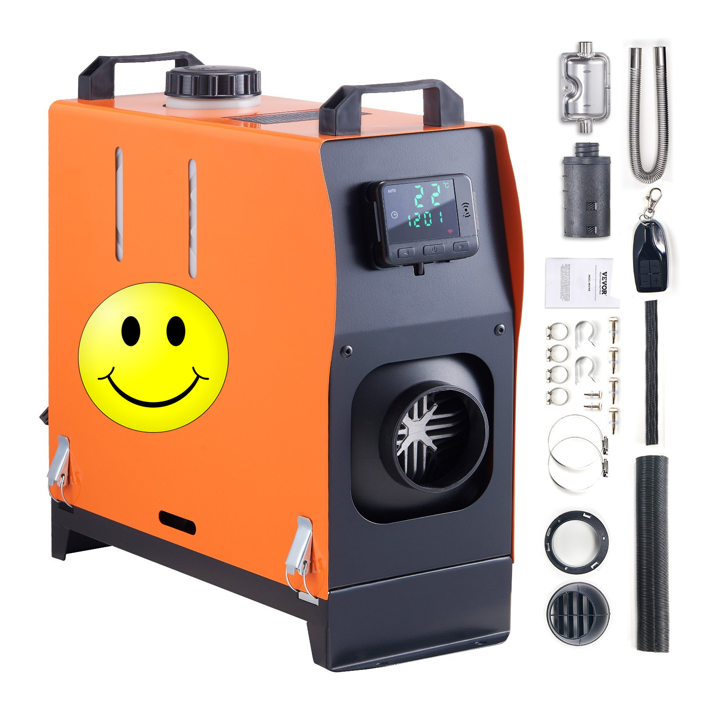

# Diesel Heater RF Codes / Коды радиоуправления дизельного отопителя

**English** | [Русский](#русский)

This repository documents an experiment in receiving and decoding the 433 MHz radio-frequency (RF) commands used by a diesel heater remote. An Arduino and an RF receiver were used to capture button presses; the resulting raw data and decoder timings are stored in `signals/`. Arduino sketches for receiving and transmitting test signals are in `arduino_tests/`.

The RC remote was tested with the diesel heater shown below.



> **Experimental project.** Captures may be incomplete, noisy, or specific to one remote/heater. This repository does not provide a certified control system.

## Repository contents

- `arduino_tests/rfgraber/rfgraber.ino` — listens for RF traffic and prints decoded data and timing parameters over Serial (115200 baud).
- `arduino_tests/heater_on/heater_on.ino` — sends a repeated test frame using an RF transmitter. The frame bytes and timing are hard-coded in the sketch.
- `signals/on.txt`, `off.txt`, `plus.txt`, `minus.txt` — captures associated with the remote's On, Off, Plus, and Minus buttons. Captures can contain repeated decodes and timing variation.
- `heater.png` — illustrative heater image.

## Hardware and setup

The sketches describe an Arduino with a 433 MHz receiver data output connected to **D2** and a transmitter data input connected to **D4**. Check your module's voltage requirements and wiring before connecting it; the sketches are examples, not a complete wiring guide.

The receiver sketch depends on **RF433any** by Sébastien Millet (`RF433any.h`); the transmitter sketch depends on **RF433send** by Sébastien Millet (`RF433send.h`). These are separate libraries and are not bundled with this repository. Install them with Arduino CLI:

```sh
arduino-cli lib install RF433any RF433send
```

Compile both sketches for Arduino Uno with:

```sh
arduino-cli compile --fqbn arduino:avr:uno arduino_tests/rfgraber
arduino-cli compile --fqbn arduino:avr:uno arduino_tests/heater_on
```

Or open each sketch folder in the Arduino IDE, select **Arduino Uno**, and compile after installing both libraries.

For receiving, open Serial Monitor at **115200 baud**, then press a remote button near the receiver. Save captures separately and compare multiple presses; do not assume one decoded frame or timing record is authoritative.

## Safety and legal notice

**Unofficial project; not affiliated with any heater manufacturer. All trademarks belong to their respective owners.**

Use only with equipment you own or are authorized to test, and only where radio transmission is permitted. Replaying a command may start or stop a fuel-burning heater. Test in a safe, ventilated environment, keep the heater's normal safety controls operational, never leave the heater unattended while it is running, and never leave an unattended test transmitter running. Incorrect wiring or operation can cause fire, burns, carbon-monoxide poisoning, equipment damage, or injury. The author(s) provide no safety, compatibility, or regulatory certification.

**Use at your own risk.** This project and its documentation are provided “AS IS,” without warranties of any kind, to the maximum extent permitted by applicable law. To that extent, the author(s) are not liable for claims, damages, or other liability arising from use of the project.

## License

Unless stated otherwise in a file, this project is licensed under the [MIT License](LICENSE). The license includes an express disclaimer of warranty and liability. Third-party libraries and images may have separate terms.

---

## Русский

Этот репозиторий описывает эксперимент по приёму и декодированию радиокоманд на частоте 433 МГц, которые использует пульт дизельного отопителя. С помощью Arduino и RF-приёмника записывались нажатия кнопок; полученные данные и параметры декодирования находятся в `signals/`. Скетчи Arduino для приёма и тестовой передачи сигналов — в `arduino_tests/`.

Пульт проверялся с дизельным отопителем, изображённым ниже.


> **Экспериментальный проект.** Записи могут быть неполными, содержать помехи или подходить только к конкретным пульту и отопителю. Это не сертифицированная система управления.

## Содержимое репозитория

- `arduino_tests/rfgraber/rfgraber.ino` — принимает радиосигналы и выводит декодированные данные и временные параметры в Serial (115200 бод).
- `arduino_tests/heater_on/pechka_on.ino` — многократно передаёт тестовый кадр через RF-передатчик. Байты и параметры сигнала заданы прямо в скетче.
- `signals/on.txt`, `off.txt`, `plus.txt`, `minus.txt` — записи сигналов кнопок On, Off, Plus и Minus. В файлах могут быть повторы и небольшие отличия временных параметров.
- `heater.png` — иллюстративное изображение отопителя.

## Оборудование и запуск

В скетчах предполагается Arduino: выход данных RF-приёмника 433 МГц подключён к **D2**, вход данных передатчика — к **D4**. Перед подключением проверьте допустимое напряжение модулей и схему распиновки: скетчи не заменяют полноценную инструкцию по подключению.

Скетч приёма зависит от библиотеки **RF433any** Sébastien Millet (`RF433any.h`); скетч передачи — от отдельной библиотеки **RF433send** того же автора (`RF433send.h`). Библиотеки не входят в репозиторий. Установите их через Arduino CLI:

```sh
arduino-cli lib install RF433any RF433send
```

Скомпилируйте оба скетча для Arduino Uno:

```sh
arduino-cli compile --fqbn arduino:avr:uno arduino_tests/rfgraber
arduino-cli compile --fqbn arduino:avr:uno arduino_tests/heater_on
```

Либо откройте папки скетчей в Arduino IDE, выберите плату **Arduino Uno** и выполните сборку после установки обеих библиотек.

Для приёма откройте Serial Monitor на скорости **115200 бод** и нажмите кнопку пульта рядом с приёмником. Сохраняйте записи отдельно и сравнивайте несколько нажатий: не считайте один кадр или один набор временных параметров окончательным.

## Безопасность и правовые условия

**Неофициальный проект, не связанный с производителями отопителей. Все товарные знаки принадлежат их соответствующим владельцам.**

Используйте проект только с оборудованием, которое принадлежит вам или на тестирование которого у вас есть разрешение, и только там, где радиопередача разрешена. Повторная передача команды может запустить или остановить отопитель, работающий на топливе. Проводите испытания в безопасном проветриваемом месте, не отключайте штатные средства защиты отопителя, не оставляйте работающий отопитель без присмотра и не оставляйте тестовый передатчик включённым без присмотра. Ошибки подключения или эксплуатации могут привести к пожару, ожогам, отравлению угарным газом, повреждению оборудования или травмам. Автор(ы) не подтверждают безопасность, совместимость или соответствие нормативным требованиям.

**Используйте на свой страх и риск.** Проект и документация предоставляются «КАК ЕСТЬ», без каких-либо гарантий, в максимально допустимой применимым законодательством степени. В этой степени автор(ы) не несут ответственности по претензиям, за ущерб или иные последствия, возникшие в связи с использованием проекта.

## Лицензия

Если в отдельном файле не указано иное, проект распространяется по лицензии [MIT](LICENSE). В ней прямо указано отсутствие гарантий и ограничение ответственности. Для сторонних библиотек и изображений могут действовать отдельные условия.
